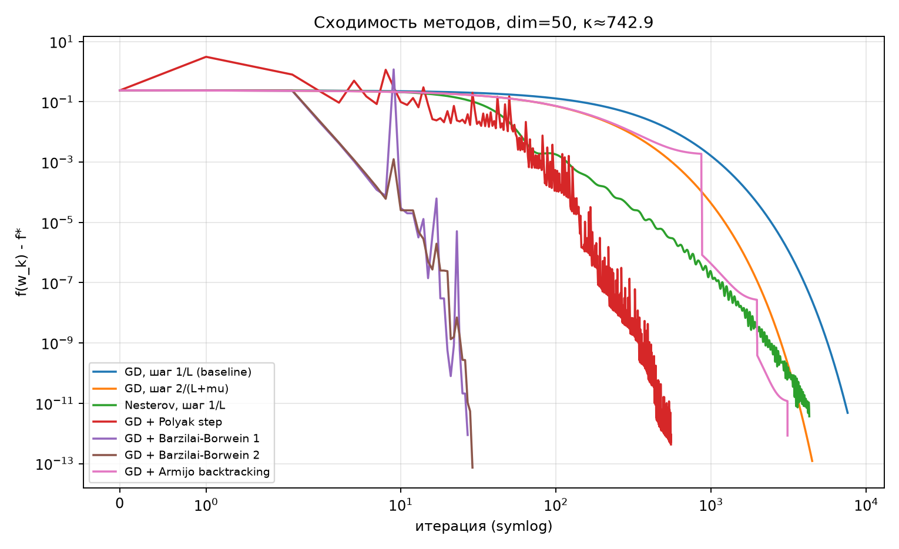
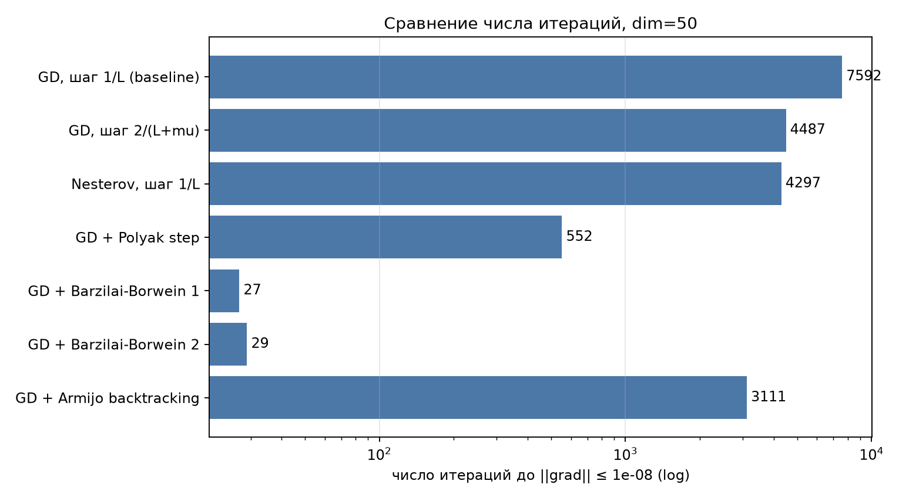
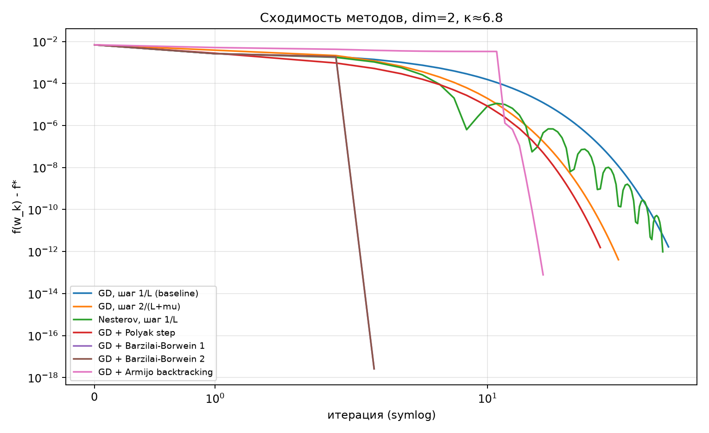
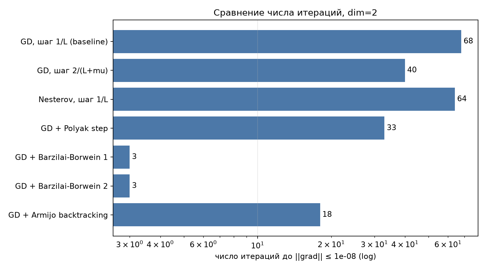
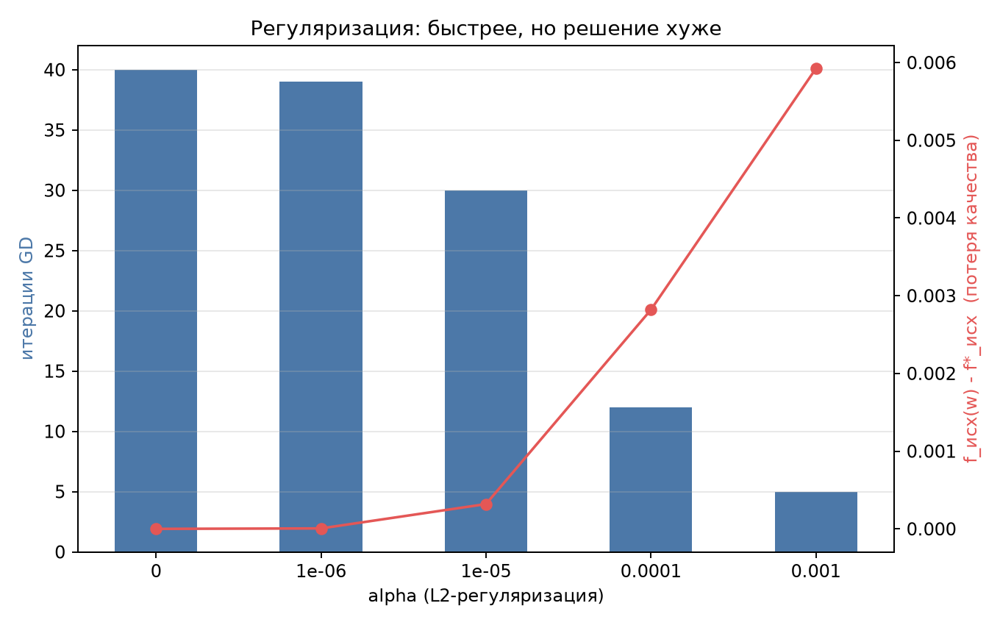
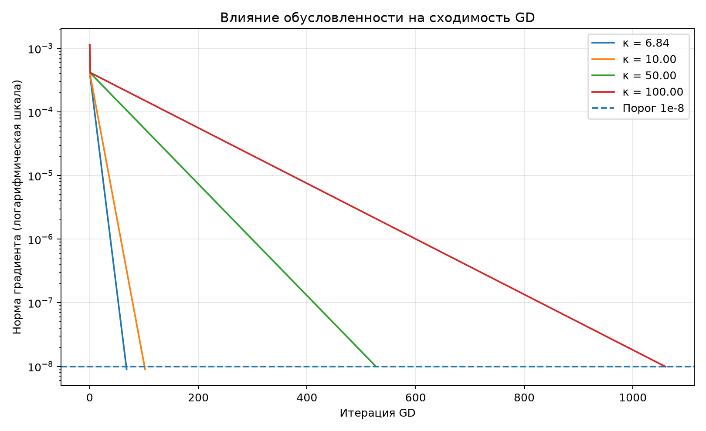
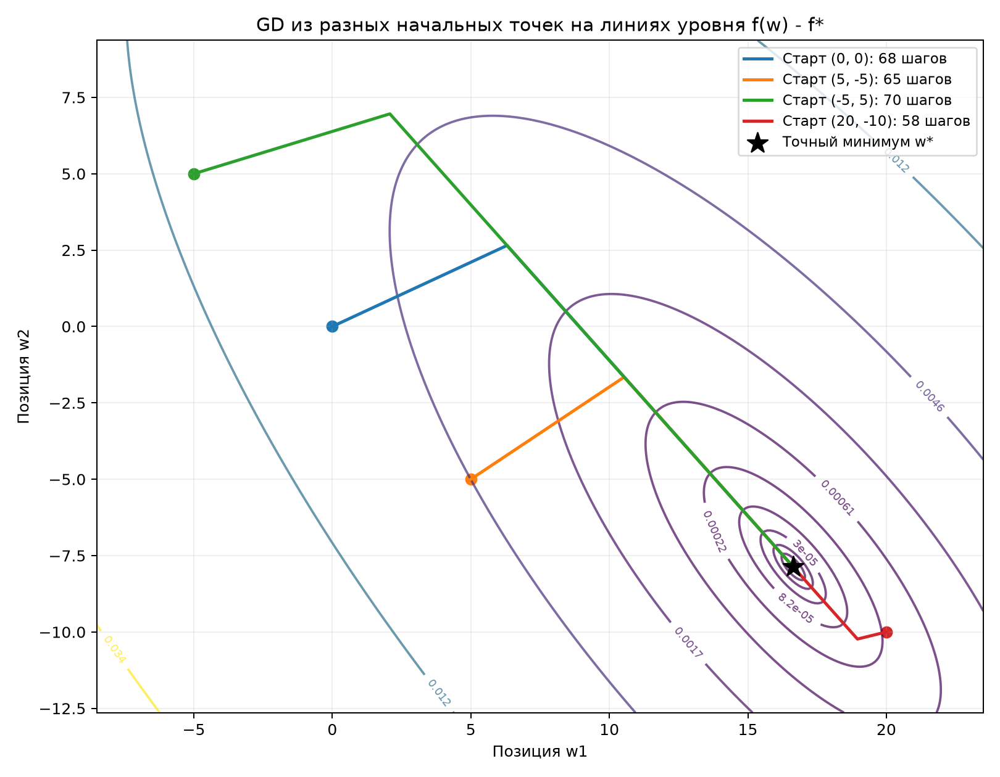

# Лабораторная работа 2. Тема 1: портфельная оптимизация Марковица

Минимизируем `f(w) = 1/2 wᵀΣw − λ μᵀw` без ограничений на `w`. Σ и μ считаются по синтетическим доходностям (300 периодов, `seed=0`). Градиент: `Σw - λμ`, гессиан: `Σ`, оптимум: `w* = Σ⁻¹λμ`.
Подробная постановка - в [`lab2/problem_statement.md`](lab2/problem_statement.md).

## Структура проекта

| Путь | Что в нем |
|---|---|
| `lab2/oracles/` | задачи: `quadratic.py` (Марковиц), `regularized_markowitz.py` (+L2), `logistic.py` |
| `lab2/methods/` | методы: `gd.py`, `nesterov.py`, `adaptive_step.py` (Polyak, BB1, BB2, Armijo) |
| `lab2/scripts/` | запускаемые эксперименты |
| `lab2/results/` | таблицы (`.csv`) и графики (`.png`) всех экспериментов |
| `lab2/utils/` | метрики, графики, логирование, seed |


## Условия экспериментов

- Критерий остановки в итоговом сравнении: `‖∇f(w_k)‖ ≤ 1e-8` для всех методов, старт `w₀ = 0`.
- Качество решения измеряется на исходной функции Марковица.
- Задача A: `dim=2`, κ ≈ 6.8 (как в экспериментах по чувствительности).
- Задача B: `dim=50`, κ ≈ 743 (большое число обусловленности).
- В отдельных экспериментах (регуляризация, чувствительность) использовались свои пороги остановки, поэтому числа итераций там могут немного отличаться от итоговой таблицы.
- Число итераций адаптивных методов (Polyak, BB, Armijo) может слегка отличаться на разных машинах из-за округлений.

## Результаты

### Задача A: dim=2

| Метод | κ задачи | Итерации | Время, мс | f−f* (исходная) | (f−f*)/abs(f*) | ‖w−w*‖ | Сошелся |
|---|---|---|---|---|---|---|---|
| GD, шаг 1/L (baseline) | 6.84 | 68 | 0.991 | 1.67e-12 | 2.39e-10 | 3.71e-04 | да |
| GD, шаг 2/(L+mu) | 6.84 | 40 | 0.891 | 4.08e-13 | 5.84e-11 | 1.41e-04 | да |
| Nesterov, шаг 1/L | 6.84 | 64 | 0.988 | 9.71e-13 | 1.39e-10 | 2.83e-04 | да |
| GD + Polyak step | 6.84 | 33 | 1.23 | 1.55e-12 | 2.23e-10 | 3.49e-04 | да |
| GD + Barzilai-Borwein 1 | 6.84 | 3 | 0.113 | 2.60e-18 | 3.73e-16 | 1.89e-14 | да |
| GD + Barzilai-Borwein 2 | 6.84 | 3 | 0.115 | 2.60e-18 | 3.73e-16 | 3.55e-15 | да |
| GD + Armijo backtracking | 6.84 | 18 | 1.1 | 7.78e-14 | 1.11e-11 | 8.00e-05 | да |
| GD + L2 (alpha=1e-06) | 6.61 | 39 | 1.26 | 5.79e-06 | 8.29e-04 | 0.684 | да |
| GD + L2 (alpha=1e-05) | 5.14 | 30 | 0.919 | 3.19e-04 | 0.0457 | 5.05 | да |
| GD + L2 (alpha=0.0001) | 2.14 | 12 | 0.356 | 2.82e-03 | 0.404 | 14.1 | да |
| GD + L2 (alpha=0.001) | 1.14 | 5 | 0.179 | 5.92e-03 | 0.848 | 17.7 | да |

### Задача B: dim=50

| Метод | κ задачи | Итерации | Время, мс | f−f* (исходная) | (f−f*)/abs(f*) | ‖w−w*‖ | Сошелся |
|---|---|---|---|---|---|---|---|
| GD, шаг 1/L (baseline) | 743 | 7592 | 171 | 4.81e-12 | 2.00e-11 | 9.64e-04 | да |
| GD, шаг 2/(L+mu) | 743 | 4487 | 89.2 | 1.22e-13 | 5.07e-13 | 1.50e-04 | да |
| Nesterov, шаг 1/L | 743 | 4297 | 64.3 | 3.68e-12 | 1.53e-11 | 7.55e-04 | да |
| GD + Polyak step | 743 | 552 | 9.82 | 4.30e-13 | 1.79e-12 | 2.87e-04 | да |
| GD + Barzilai-Borwein 1 | 743 | 27 | 0.714 | 8.86e-13 | 3.69e-12 | 2.87e-04 | да |
| GD + Barzilai-Borwein 2 | 743 | 29 | 0.949 | 7.34e-14 | 3.05e-13 | 1.09e-04 | да |
| GD + Armijo backtracking | 743 | 3111 | 110 | 8.47e-13 | 3.53e-12 | 4.05e-04 | да |

Полные таблицы: [`summary_dim2.csv`](lab2/results/final/summary_dim2.csv),
[`summary_dim50.csv`](lab2/results/final/summary_dim50.csv).

### Сходимость методов (dim=50)



### Число итераций (dim=50)



### Сходимость и итерации (dim=2)




### Улучшение обусловленности: L2-регуляризация

Добавляем `α/2‖w‖²`, гессиан становится `Σ + αI`, число обусловленности уменьшается.
Оптимум при этом смещается, поэтому уменьшение числа итераций нужно читать вместе с потерей качества на исходной функции.



### Зависимость от числа обусловленности и параметров

Результаты скриптов `condition_analysis` и `parameter_sensitivity`
(шаг GD `1/L`, `dim=2`, `tol=1e-8`):

| κ | 6.84 | 10 | 50 | 100 |
|---|---|---|---|---|
| Итераций GD | 68 | 102 | 527 | 1060 |
| w₁*, w₂* | 16.6, −7.9 | 22.2, −13.6 | 93.0, −85.6 | 181.5, −175.7 |

- Число итераций GD растет примерно линейно с κ.
- Оптимум линейно зависит от λ: при λ = 0.5 / 1 / 2 получаем w* = (8.3, −3.9) / (16.6, −7.9) / (33.3, −15.7), число итераций почти не меняется (63 / 68 / 72).
- Начальная точка влияет слабо: из четырех стартов, включая (20, −10), GD приходит в один и тот же оптимум за 58–70 итераций.




## Выводы

1. **Число обусловленности определяет скорость сходимости.** Для GD с шагом `1/L` число итераций пропорционально κ: при росте κ с 6.8 до 743 (примерно в 110 раз) число итераций выросло с 68 до 7592 (тоже примерно в 110 раз). От κ зависит и сам оптимум: при κ = 100 веса равны примерно 181 и −176 против 17 и −8 при κ = 6.8, то есть решение состоит из крупных длинных и коротких позиций и сильно зависит от матрицы Σ.
2. **Шаг `2/(L+μ)` вместо `1/L`** ускоряет GD примерно в 1.7 раза (68→40 при dim=2, 7592→4487 при dim=50) при том же качестве решения.
3. **Метод Нестерова** почти не меняет число итераций при малом κ (68→64) и дает ускорение около 1.8 раза при большом κ (7592→4297).
4. **Шаг Армихо (backtracking)** сокращает число итераций примерно в 2.4 раза (3111 при dim=50), но на каждой итерации требуется несколько вычислений `f`, поэтому по времени он не быстрее GD с шагом `2/(L+μ)` (≈ 110 мс против ≈ 89 мс; время зависит от машины).
5. **Шаг Поляка** (552 итерации при dim=50, примерно в 14 раз меньше baseline) использует значение `f*`. Здесь оно известно из аналитического решения, а в общем случае его нет, поэтому результат показывает, чего можно достичь при известном `f*`.
6. **Шаги Барзилай-Борвейна (BB1, BB2)** дают лучший результат: 27–29 итераций при dim=50 против 7592 у baseline (в 260–280 раз меньше) без знания `f*` и без дополнительных вычислений функции. Особенность метода - немонотонное поведение `f(w_k)` (видны «всплески» на графике). При dim=2 BB сходится за 3 итерации: это особенность двумерной задачи, поэтому для сравнения методов основной является задача B (dim=50).
7. **L2-регуляризация** уменьшает κ и число итераций (40 → 39 → 30 → 12 → 5 при α = 0, 1e-6, 1e-5, 1e-4, 1e-3 для dim=2), при этом решается уже другая задача. Потеря на исходной функции относительно ее оптимального значения: 0.08 % (α = 1e-6), 4.6 % (1e-5), 40 % (1e-4), 85 % (1e-3). Регуляризация уменьшает веса портфеля, поэтому ее применяют при малых α, когда нужны более умеренные позиции, а как способ ускорить GD она уступает адаптивным шагам.

**Итог.** Для задачи Марковица без ограничений наибольшее ускорение дает адаптивный шаг Барзилай-Борвейна (около 30 итераций вместо 7592), простое улучшение - шаг `2/(L+μ)`. L2-регуляризацию стоит выбирать, когда нужны более умеренные веса портфеля, учитывая компромисс между скоростью сходимости и качеством на исходной функции.

<details>
<summary>Исходный текст задания</summary>

# Тема 1: Портфельная оптимизация Марковица
Рассмотрим n активов. Пусть ri — случайная доходность актива i за пери-
од (например, за день, неделю или год). Вектор доходностей: r ∈ Rn
Портфель задаётся вектором весов w ∈ Rn, где компоненты w — доля
капитала, вложенная в актив i. Доходность портфеля — это линейная
комбинация: rp = r^w=Pni=1riwi
Если вектор ожидаемых доходностей μ = E[r] ∈ Rn, а матрица ко-
вариаций доходностей Σ ∈ Rn×n, тогда ожидаемая доходность портфеля
E[rp] = μTw. Функция 1/2wTΣw − λμTw.

1. Обоснование формулы моделирования процесса (для второй лабораторной работы рекомендуется использовать дополнительные слагаемые вместо задачи с ограничениями -- что является предметом исследования в третьей лабораторной работе)
2. Реализовать синтетический источник данных (значение функции и градиент в точке, опционально гессиан)
3. Реализовать градиентный спуск (gradient descent GD) для бейзлайна
4. Оценить качество оптимизации и обусловленность поставленной задачи
5. Улучшить качество оптимизации (повышение обсуловленности через изменение оптимизируемой функции И/ИЛИ использования модифицированных и адаптивных алгоритмов)
6. Сделать выводы работы, включая сравнительнение качества (количественная характеристика полученного решения относительно исходной задачи или числа итераций) использованных подходов

Список задач с необходимыми (чёрный круг) и возможными (белый) атрибутами решения:


Прежде начала работы над выбранной задачей необходимо реализовать предложенные оракулы и градиентный спуск, проверить корректность можно командами 
```
python -m scripts.run_experiment --config configs/quadratic_gd.yaml
python -m scripts.run_experiment --config configs/logistic_gd.yaml
python -m scripts.run_experiment --config configs/quadratic_adaptive.yaml
```


</details>
