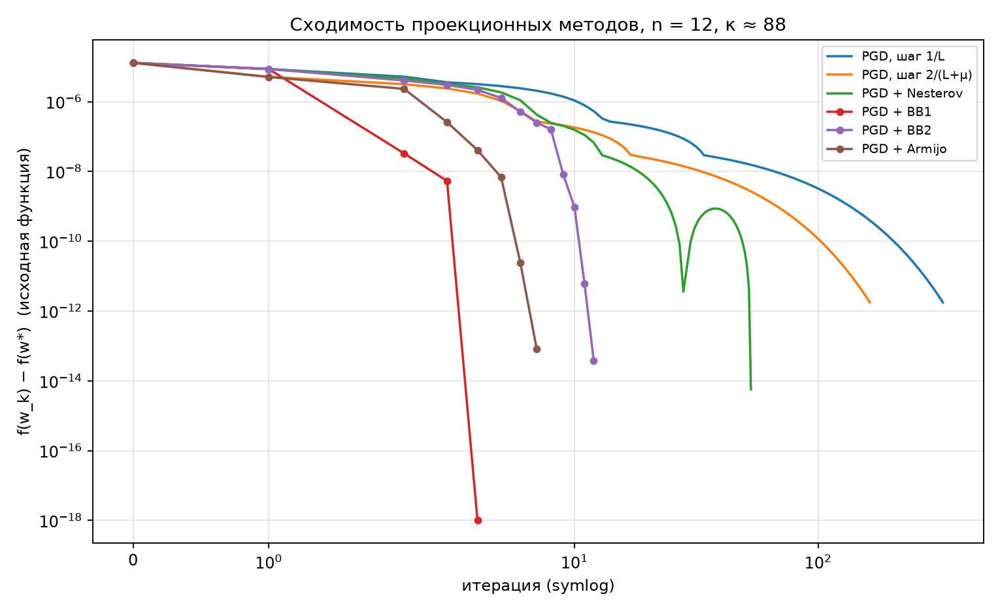
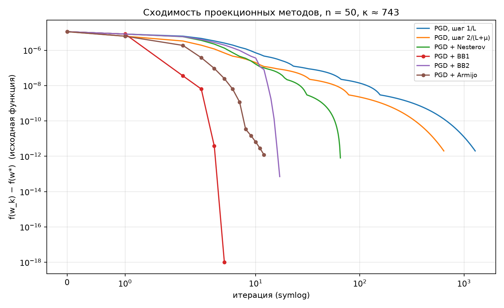
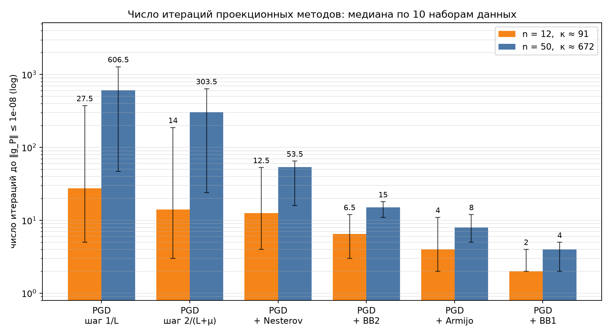
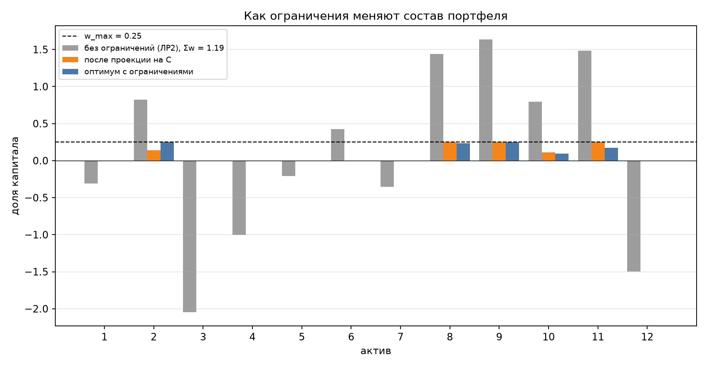
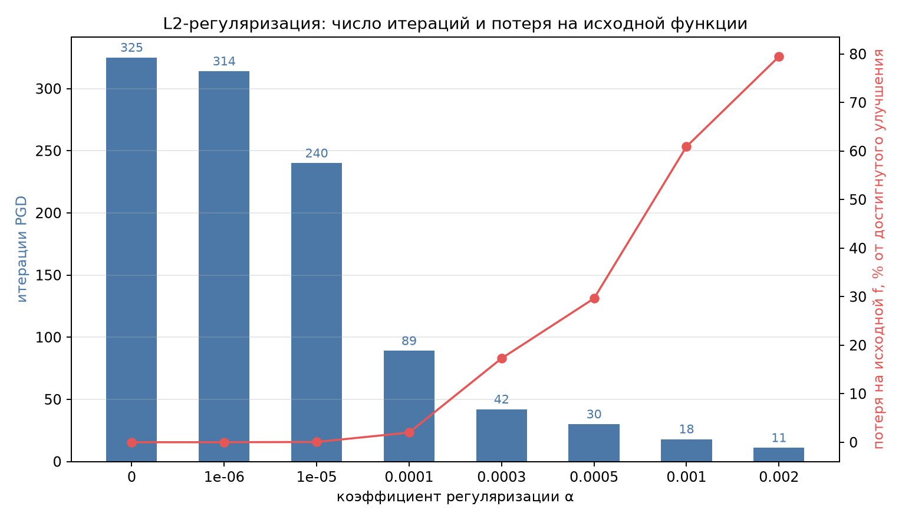
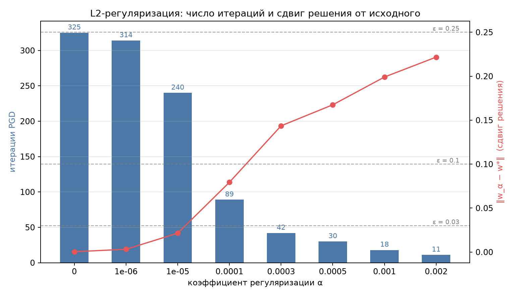

# Лабораторная работа 3. Итоговое сравнение: портфель Марковица с ограничениями

В ЛР2 мы минимизировали функцию Марковица без ограничений. В ЛР3 функция та же, но веса портфеля должны удовлетворять ограничениям, которые имеют смысл для реального портфеля. Здесь собраны итоговые таблицы, графики и выводы по всей работе: как меняются постановка, методы решения и качество результата.

## 1. Обозначения и их смысл в задаче

| Обозначение | Что это | Смысл в задаче |
|---|---|---|
| `n` | число активов | сколько бумаг в портфеле (в экспериментах 12 и 50) |
| `w ∈ Rⁿ` | вектор весов | `wᵢ` - доля капитала, вложенная в актив `i` |
| `μ ∈ Rⁿ` | оценка ожидаемых доходностей за период | на сколько в среднем растет каждый актив |
| `Σ ∈ Rⁿˣⁿ` | оценка ковариационной матрицы доходностей | мера риска: `wᵀΣw` - дисперсия доходности портфеля |
| `λ` | вес доходности в целевой функции (`λ = 0.05`) | чем больше `λ`, тем сильнее инвестор готов рисковать ради доходности |
| `f(w) = ½ wᵀΣw − λ μᵀw` | целевая функция | компромисс «риск против доходности», ее минимизируем |
| `w_max` | максимальная доля одного актива (`3/n`) | диверсификация: нельзя вложить в одну бумагу больше `w_max` капитала |
| `r_min` | минимально допустимая ожидаемая доходность | инвестор не согласен на портфель с меньшей `μᵀw` |
| `C` | допустимое множество | все портфели, удовлетворяющие всем ограничениям |
| `Π_C` | евклидова проекция на `C` | ближайший к заданному вектору допустимый портфель |
| `η_k` | шаг метода на итерации `k` | насколько далеко двигаемся против градиента |
| `g_P(w)` | отображение проецированного градиента | равно нулю в оптимуме; по его норме останавливаем методы |
| `κ` | число обусловленности `λ_max(Σ) / λ_min(Σ)` | чем больше `κ`, тем медленнее градиентные методы |
| `w*` | эталонный оптимум задачи с ограничениями | точка, с которой сравниваем решения |
| `α` | коэффициент L2-регуляризации | сила штрафа за большие веса |
| `F_α(w) = f(w) + (α/2)‖w‖²` | изменённая (регуляризованная) цель | задача, которую решаем при `α > 0` |
| `ε` | допустимый сдвиг решения | насколько новый портфель может отличаться от исходного |

## 2. Постановка и смысл ограничений

```text
min f(w) = ½ wᵀΣw − λ μᵀw
при  Σᵢ wᵢ = 1,   0 ≤ wᵢ ≤ w_max,   μᵀw ≥ r_min.
```

| Ограничение | Смысл для реального портфеля |
|---|---|
| `Σᵢ wᵢ = 1` | весь капитал распределен между активами |
| `wᵢ ≥ 0` | нет коротких позиций (нельзя продавать бумаги, которых нет) |
| `wᵢ ≤ w_max` | ограничение концентрации: один актив не больше `w_max` портфеля |
| `μᵀw ≥ r_min` | гарантированный минимум ожидаемой доходности |

Допустимое множество непусто, если `n · w_max ≥ 1` и `r_min` не превышает максимальную доходность на ограниченном симплексе. Подробный вывод условий оптимальности (KKT) - в [`LAB3_MATHEMATICAL_MODEL.md`](LAB3_MATHEMATICAL_MODEL.md).

Все сравниваемые методы проекционные: `w_(k+1) = Π_C( w_k − η_k ∇f(w_k) )`. Проекция гарантирует допустимость каждой итерации.

## 3. Условия сравнения

- Данные: синтетические доходности (`n_periods = 300`), основной набор `seed = 0`; для проверки устойчивости те же методы запущены на 10 наборах (`seed = 0…9`).
- Две задачи: `n = 12` (`w_max = 0.25`) и `n = 50` (`w_max = 0.06`); у них разное число обусловленности `κ`.
- `λ = 0.05` взято как в эксперименте по чувствительности к ограничениям. При `λ = 1` оптимум лежит практически в вершине допустимого множества (почти все веса равны 0 или `w_max`), и все методы сходятся за 2–14 итераций, поэтому различия между ними не видны.
- `r_min = r_base + 0.5 (r_max − r_base)`, где `r_base` - доходность оптимального портфеля без требования по доходности, `r_max` - максимально достижимая доходность при ограничении долей. Так ограничение по доходности становится активным и влияет на решение.
- Начальная точка одна для всех методов: равные веса `1/n`, спроецированные на `C`; ее допустимость проверяется (раздел 4).
- Критерий остановки одинаков: `‖g_P(w_k)‖ ≤ 1e-8`, где `g_P(w) = L · (w − Π_C(w − ∇F(w)/L))`.
- Эталон `w*`: решение SLSQP, доведенное проекционным методом до `‖g_P‖ ≤ 1e-12` (невязка эталона порядка `1e-16`).
- Метрики: число итераций; число проекций на `C`, выполненных самим методом; разрыв `f(w) − f(w*)` на исходной функции; расстояние `‖w − w*‖`; максимальное нарушение ограничений по всей траектории.

## 4. Начальная точка

| Начальная точка | Допустима | f(w₀) − f* | ‖w₀ − w*‖ | ‖g_P(w₀)‖ | Итер. PGD 1/L | Итер. BB1 |
|---|---|---|---|---|---|---|
| Равные веса 1/n, спроецированные на C | да | 1.30e-05 | 0.249 | 8.57e-05 | 325 | 4 |
| Внутренняя точка (oracle.feasible_start) | да | 1.38e-05 | 0.306 | 8.51e-05 | 191 | 4 |
| Случайный вектор, спроецированный на C | да | 1.31e-05 | 0.258 | 5.77e-05 | 220 | 4 |

Все три начальные точки допустимы (нарушение ограничений равно нулю). Они близки по качеству: `f(w₀) − f*` и `‖g_P(w₀)‖` одного порядка, расстояние до `w*` составляет 0.25–0.31. От выбора точки число итераций PGD зависит (191–325), а у BB1 одинаково (4).

## 5. Сравнение методов

Ускорение считается как число итераций PGD с шагом `1/L`, деленное на число итераций метода. Все решения допустимы, а нарушения ограничений на всей траектории не превышают `10⁻¹²`.

### Один набор данных (seed = 0)

**n = 12, κ ≈ 88**

| Метод | Итерации | Проекций на C | Ускорение к PGD 1/L | f − f* (исходная) | ‖w − w*‖ | Макс. нарушение | Допустим |
|---|---|---|---|---|---|---|---|
| PGD, шаг 1/L | 325 | 325 | 1 | 1.77e-12 | 3.59e-04 | 1.88e-13 | да |
| PGD, шаг 2/(L+μ) | 163 | 163 | 1.99 | 1.78e-12 | 3.59e-04 | 1.55e-13 | да |
| PGD + Nesterov | 53 | 53 | 6.13 | 5.67e-15 | 2.03e-05 | 1.89e-13 | да |
| PGD + BB1 | 4 | 4 | 81.2 | 1.56e-19 | 2.35e-12 | 1.88e-13 | да |
| PGD + BB2 | 12 | 12 | 27.1 | 3.79e-14 | 5.25e-05 | 1.91e-13 | да |
| PGD + Armijo | 7 | 8 | 46.4 | 8.27e-14 | 7.75e-05 | 1.87e-13 | да |

**n = 50, κ ≈ 743**

| Метод | Итерации | Проекций на C | Ускорение к PGD 1/L | f − f* (исходная) | ‖w − w*‖ | Макс. нарушение | Допустим |
|---|---|---|---|---|---|---|---|
| PGD, шаг 1/L | 1281 | 1281 | 1 | 2.01e-12 | 4.03e-04 | 4.53e-13 | да |
| PGD, шаг 2/(L+μ) | 640 | 640 | 2 | 2.02e-12 | 4.04e-04 | 5.16e-13 | да |
| PGD + Nesterov | 65 | 65 | 19.7 | 8.09e-13 | 2.56e-04 | 3.84e-13 | да |
| PGD + BB1 | 5 | 5 | 256 | 9.93e-17 | 1.70e-06 | 1.51e-13 | да |
| PGD + BB2 | 17 | 17 | 75.4 | 7.11e-14 | 7.58e-05 | 4.58e-13 | да |
| PGD + Armijo | 12 | 15 | 107 | 1.22e-12 | 3.14e-04 | 3.73e-13 | да |

Для сравнения: обычный GD без ограничений (как в ЛР2) на тех же данных и из той же точки делает 670 итераций при `n = 12` и 5400 при `n = 50`.




### Устойчивость: 10 наборов данных

Набор `seed = 0` при `n = 12` оказался более «тяжелым», чем типичный (325 итераций у PGD с шагом `1/L` против медианы 27.5), поэтому для обобщений используем медианы.

| n | Метод | κ (медиана) | Итерации (медиана) | Размах |
|---|---|---|---|---|
| 12 | PGD, шаг 1/L | 91 | 27.5 | 5–375 |
| 12 | PGD, шаг 2/(L+μ) | 91 | 14 | 3–188 |
| 12 | PGD + Nesterov | 91 | 12.5 | 4–53 |
| 12 | PGD + BB1 | 91 | 2 | 2–4 |
| 12 | PGD + BB2 | 91 | 6.5 | 3–12 |
| 12 | PGD + Armijo | 91 | 4 | 2–11 |
| 50 | PGD, шаг 1/L | 672 | 606 | 47–1281 |
| 50 | PGD, шаг 2/(L+μ) | 672 | 304 | 24–640 |
| 50 | PGD + Nesterov | 672 | 53.5 | 16–65 |
| 50 | PGD + BB1 | 672 | 4 | 2–5 |
| 50 | PGD + BB2 | 672 | 15 | 11–18 |
| 50 | PGD + Armijo | 672 | 8 | 5–12 |



Методы на графике упорядочены по числу итераций на большей задаче; столбики показывают медиану, «усы» - минимум и максимум по наборам данных.

## 6. Как ограничения меняют решение

Сравниваем три портфеля (`n = 12`): оптимум ЛР2 без ограничений, он же после проекции на `C` и оптимум с ограничениями.

| Портфель | Σw | min w | max w | Ожид. доходность | f (исходная) | f − f* | ‖w − w*‖ | Допустим |
|---|---|---|---|---|---|---|---|---|
| Оптимум без ограничений (ЛР2) | 1.19 | -2.05 | 1.64 | 8.04e-03 | -2.01e-04 | -1.91e-04 | 3.72 | нет |
| Он же после проекции на C | 1 | 0 | 0.25 | 1.34e-03 | -8.48e-06 | 2.06e-06 | 0.139 | да |
| Оптимум с ограничениями (эталон) | 1 | 0 | 0.25 | 1.28e-03 | -1.05e-05 | 0 | 0 | да |



## 7. L2-регуляризация

К функции добавляется штраф `(α/2)‖w‖²`: гессиан становится `Σ + αI`, число обусловленности уменьшается, но оптимум смещается. Поэтому качество показано отдельно на исходной функции `f` и на изменённой `F_α`, а сдвиг решения измерен расстоянием до исходного оптимума `w*`. Потеря на исходной функции выражена в процентах от улучшения, достигнутого оптимизацией (`f(w₀) − f*`).

| α | κ(α) | Итерации | f (исходная) | F_α (изменённая) | Потеря, % от улучшения | ‖w_α − w*‖ | Макс. нарушение |
|---|---|---|---|---|---|---|---|
| 0 | 88.4 | 325 | -1.05e-05 | -1.05e-05 | 1.37e-05 | 3.59e-04 | 2.17e-19 |
| 1.00e-06 | 84 | 314 | -1.05e-05 | -1.04e-05 | 1.04e-03 | 3.13e-03 | 0 |
| 1.00e-05 | 58.1 | 240 | -1.05e-05 | -9.45e-06 | 0.0488 | 0.0214 | 0 |
| 1.00e-04 | 14.8 | 89 | -1.03e-05 | 5.57e-09 | 1.99 | 0.0793 | 0 |
| 3.00e-04 | 6.16 | 42 | -8.30e-06 | 1.89e-05 | 17.3 | 0.144 | 1.11e-16 |
| 5.00e-04 | 4.17 | 30 | -6.70e-06 | 3.67e-05 | 29.6 | 0.167 | 2.17e-19 |
| 1.00e-03 | 2.61 | 18 | -2.65e-06 | 7.82e-05 | 60.9 | 0.199 | 2.17e-19 |
| 2.00e-03 | 1.81 | 11 | -2.47e-07 | 1.58e-04 | 79.5 | 0.222 | 0 |

Попадание в `ε`-окрестность исходного решения (`‖w_α − w*‖ ≤ ε`): при `ε = 0.03` подходят `α ≤ 1e-5`, при `ε = 0.10` - `α ≤ 1e-4`, при `ε = 0.25` - все рассмотренные `α`. Ожидаемая доходность во всех случаях равна `r_min = 1.28e-3`, то есть ограничение остается активным, а меняется состав портфеля и его риск: дисперсия растет с `1.06e-4` при `α = 0` до `1.27e-4` при `α = 2e-3` (примерно на 20 %).




## 8. Выводы

1. **Ограничения меняют решение принципиально.** Оптимум без ограничений недопустим: сумма весов 1.19, веса от −2.05 до 1.64, то есть большие плечи и короткие позиции. Допустимый оптимум имеет сумму 1, веса от 0 до `w_max`; за это приходится платить: значение `f` растет с `−2.0·10⁻⁴` до `−1.05·10⁻⁵`, а ожидаемая доходность падает с 0.80 % до 0.13 % за период.
2. **Проекция безусловного решения не дает оптимума с ограничениями.** После проекции портфель допустим, но разрыв по `f` составляет `2.1·10⁻⁶` (около 16 % улучшения, достигнутого оптимизацией от равных весов), расстояние до `w*` равно 0.139. Ограничения нужно учитывать в самой задаче, а не накладывать после решения.
3. **Допустимость сохраняется.** Начальная точка допустима (проверено для трех вариантов), проекция возвращает допустимый портфель на каждой итерации: нарушения ограничений не превышают `10⁻¹²`.
4. **Порядок методов тот же, что в ЛР2, но итераций меньше.** При `n = 50` обычный GD без ограничений делает 5400 итераций, PGD с шагом `1/L` - 1281. Шаг `2/(L+μ)` ускоряет метод в 2 раза, Нестеров в 6 (`n = 12`) и 20 (`n = 50`) раз, Армихо в 46 и 107 раз, BB1 в 81 и 256 раз. Медианы по 10 наборам данных дают ту же картину: при `n = 50` у PGD с шагом `1/L` 606 итераций, у BB1 - 4. Выигрыш BB1 столь велик потому, что на решении seed = 0 только три веса лежат строго внутри границ, а два активных равенства (бюджет и доходность) оставляют одну степень свободы.
5. **Зависимость от числа обусловленности сохраняется, но слабее и менее предсказуема.** При росте медианного `κ` с 91 до 672 медиана итераций PGD с шагом `1/L` выросла с 27.5 до 606, а у BB1 - с 2 до 4. Разброс по наборам данных большой (у PGD при `n = 12` от 5 до 375 итераций), потому что скорость определяется обусловленностью на «свободных» активах, а не всей матрицы `Σ`.
6. **Регуляризация ускоряет метод ценой другого портфеля.** При `α` от 0 до `2·10⁻³` число обусловленности падает с 88 до 1.8, а итераций становится 11 вместо 325. Но потеря на исходной функции растет: 0.05 % (`α = 1e-5`), 2.0 % (`1e-4`), 17 % (`3e-4`), 61 % (`1e-3`), 79 % (`2e-3`), расстояние до исходного оптимума достигает 0.22, риск растет. Умеренное `α = 1e-4` дает 89 итераций (в 3.7 раза меньше) при потере 2 % и сдвиге 0.08. На изменённой функции `F_α` метод сходится, но ее значение отличается от значения исходной `f` на штраф `(α/2)‖w‖²`, поэтому оценивать качество только по `F_α` нельзя.
7. **Рекомендации.** Для скорости при заданных ограничениях лучше использовать проекционный градиентный спуск с шагом Барзилай–Борвейна или Армихо: они сокращают число итераций в десятки и сотни раз без потери качества и без нарушения ограничений. Регуляризацию стоит применять только если нужны более «спокойные» веса, выбирая `α` по сдвигу решения (`ε`-окрестности) и потере на исходной функции, а не по числу итераций.

## 9. Объём исследования и запуск

Ограничение на максимальный риск `wᵀΣw ≤ q_max` в проекционных методах не используется; его влияние на оптимум исследовано отдельно в `scripts/constraint_sensitivity.py` (решатель SLSQP, результаты в `results/constraint_sensitivity/`).

Числа итераций BB и Армихо могут слегка отличаться на разных машинах из-за округлений.

Запуск (из папки `lab2/`, нужны `numpy`, `scipy`, `matplotlib`):

```bash
cd lab2
python -m scripts.final_comparison_lab3
```

Результаты (таблицы `.csv`, `summary_lab3.md` и графики) сохраняются в `lab2/results/lab3_final/`. Порядок методов на графике числа итераций переключается константой `SORT_DESCENDING` в начале скрипта.
